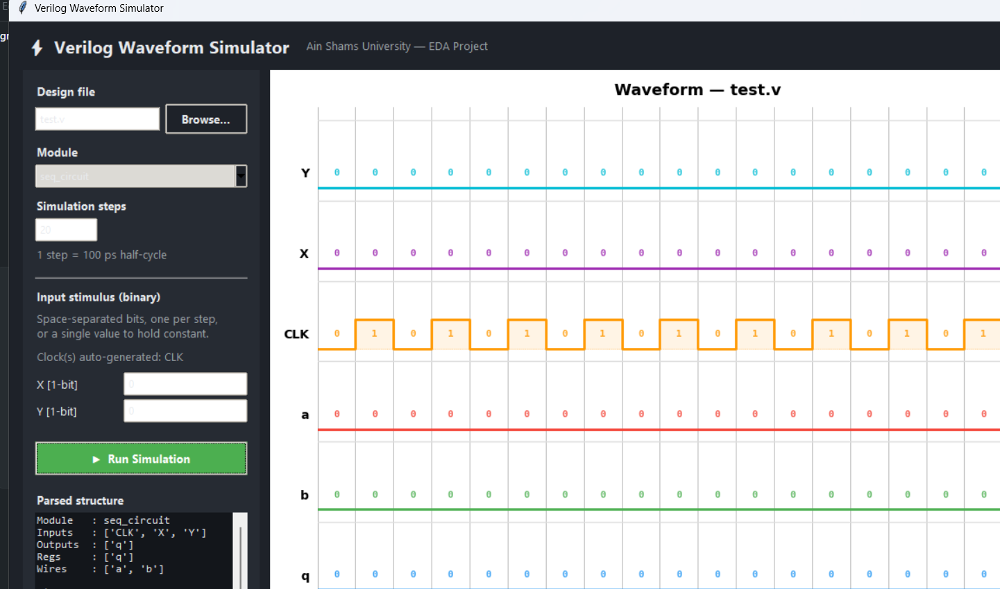

# Verilog Waveform Simulator

A small, educational Verilog parser, discrete-time simulator, and digital waveform
viewer — written entirely in Python using only the standard library and
**matplotlib**. It parses a restricted-but-useful subset of Verilog (ports,
`wire`/`reg`, `assign`, and `always` blocks with `if`/`case`, blocking and
non-blocking assignment, and bit-concatenation), simulates it over discrete
time steps, and renders the result as a color-coded digital timing diagram —
either in a desktop GUI or a terminal + popup-window workflow.

Built as an EDA (Electronic Design Automation) course project at the Faculty of
Engineering, Ain Shams University, Department of Electronics and Communications
Engineering.



## Features

- **Verilog subset parser** (`parser.py`) — regex-based, no external dependency.
  Supports multi-bit buses (`[3:0]`), `parameter`-driven widths, ANSI and
  non-ANSI port declarations, `assign` statements, and `always @(posedge/negedge
  clk)` / `always @(*)` blocks with `if/else`, `case/endcase`, blocking (`=`)
  and non-blocking (`<=`) assignment, and concatenation targets (`{cout, d} = ...`).
- **Discrete-time simulator** (`simulator.py`) — topologically sorts combinational
  `assign` dependencies, auto-detects and generates clock signals, and executes
  sequential `always` blocks on the correct clock edge.
- **Digital waveform renderer** (`waveform.py`) — color-coded, binary-annotated
  stepped traces with inputs on top / outputs on the bottom, like a real
  waveform viewer. Works both as a standalone matplotlib window and embedded
  inside the GUI.
- **Desktop GUI** (`gui.py`) — load any `.v` file, pick a module, type binary
  stimulus per input, and see the waveform redraw inline, no popups.
- **Multi-module files** — pick which `module ... endmodule` block to simulate
  when a file defines more than one.

## Project structure

| File | Responsibility |
|---|---|
| `gui.py` | Desktop GUI (Tkinter) — recommended way to run the project |
| `main.py` | Command-line entry point (terminal prompts + popup waveform window) |
| `parser.py` | Regex-based Verilog → structured dictionary |
| `simulator.py` | Stimulus generation, expression evaluation, always-block execution |
| `waveform.py` | matplotlib waveform rendering (shared by GUI and CLI) |
| `test.v` | Sample design — synchronous circuit with a D-latch-style feedback path |
| `requirements.txt` | Python dependencies (`matplotlib`) |
| `DOCUMENTATION.md` | Full internal documentation of every module and function |

## Installation

Requires **Python 3.8+**.

```bash
pip install -r requirements.txt
```

Tkinter ships with the standard Python installer on Windows/macOS; on Linux
install it via your package manager if missing (e.g. `sudo apt install
python3-tk`).

## Running

### GUI (recommended)

```bash
python gui.py
```

1. **Browse…** to pick a `.v` file (defaults to the bundled `test.v`).
2. Pick a **module** if the file defines more than one.
3. Set the number of **simulation steps**.
4. Type a binary stimulus for each non-clock input (space-separated, one value
   per step, or a single value to hold it constant). Clock inputs are detected
   automatically and don't need a value.
5. Click **Run Simulation** — the waveform redraws in the panel on the right,
   and the parsed module structure is shown on the left.

### Command line

```bash
python main.py                 # uses test.v, first module in the file
python main.py path/to/file.v  # explicit file
python main.py file.v my_mod   # explicit file + module name
```

The CLI prompts for simulation steps and per-signal binary stimulus in the
terminal, prints a binary signal table, then opens the waveform in its own
matplotlib window.

## Supported Verilog constructs

**Supported:** `module`/`endmodule`, ANSI and non-ANSI `input`/`output`/`inout`
ports (scalar and `[msb:lsb]` buses), `wire`/`reg`, `parameter`-based widths,
`assign`, `always @(*)` and `always @(posedge/negedge clk)`, `if`/`else`,
`case`/`endcase` (with `default`), blocking/non-blocking assignment,
concatenation assignment targets, binary/hex/decimal sized literals
(`4'b1010`, `8'hFF`, `8'd200`), bitwise/logical/arithmetic operators, and the
ternary operator `cond ? a : b`.

**Not supported:** multiple sensitivity-list items (e.g. async reset),
multi-line `assign` statements, functions/tasks, `generate` blocks, module
instantiation, memories/arrays, `X`/`Z` states, and timing delays (`#10`). See
`DOCUMENTATION.md` for the full rationale.

## Limitations

- Expressions are evaluated with Python's `eval()` after substitution — fine
  for trusted local `.v` files, not safe for untrusted input.
- Only the first (or explicitly chosen) module in a file is simulated.
- Combinational loops fall back to original declaration order without warning.

## License

Educational project — use freely for learning purposes.
