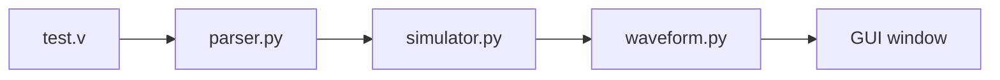

# Verilog Waveform Parser — Project Documentation

This document explains how the project is structured, how data flows through it, and what each source file does. The goal is to take a small subset of Verilog (combinational `assign` statements), simulate signal values over discrete time steps, and plot the result in a matplotlib window.

---

## High-level pipeline

The program is a straight pipeline with four stages:

1. **Load** — Read a `.v` file as text.
2. **Parse** — Extract `input` / `output` port names and `assign` lines using regular expressions.
3. **Simulate** — For each time step, apply default test patterns to inputs, evaluate each `assign` right-hand side, and append computed outputs to per-signal lists.
4. **Plot** — Draw each signal as a stepped trace (digital waveform) and show an interactive window.



There is no database or config file: `main.py` wires everything together and points at `test.v` by default.

---

## Dependencies

- **Python 3** with the standard library (`pathlib`, `re`, `eval` context).
- **matplotlib** (see `requirements.txt`) for plotting. An interactive backend (Tk/Qt) is required for a visible window; see `waveform.py`.

Install:

```text
pip install -r requirements.txt
```

---

## File reference

### `main.py` — Entry point

**Role:** Resolve the project directory, read the Verilog file, run parse → simulate → plot.

- `Path(__file__).resolve().parent` stores the folder containing `main.py`, so `test.v` is loaded correctly even if you run Python from another working directory.
- `read_text(encoding="utf-8")` reads the whole file as one string (no need to manually `close()` the file).
- Execution order: `parse_verilog(code)` → `simulate(parsed)` → `plot_wave(signals)`.

**Data passed between stages:**

- `code` — Raw Verilog source string.
- `parsed` — Dictionary produced by the parser (see below).
- `signals` — Dictionary mapping each signal name to a list of 0/1 values, one entry per time step.

---

### `parser.py` — Verilog text → structured data

**Role:** Turn unstructured Verilog text into a small Python structure the simulator can use. This is **not** a full Verilog compiler; it uses **regular expressions** only.

**Steps inside `parse_verilog`:**

1. **Strip line comments** — `re.sub(r'//.*', '', code)` removes everything from `//` to the end of each line so comments do not break later patterns.
2. **Match `input` lines** — `input\s+(.+?);` captures the list between `input` and `;` (e.g. `A, B`).
3. **Match `output` lines** — Same idea for `output`.
4. **Match `assign` lines** — `assign\s+(\w+)\s*=\s*(.+?);` captures:
   - Group 1: left-hand side signal name (must be a single word `\w+`).
   - Group 2: the expression up to the semicolon (non-greedy `.+?`).

**`split_vars`:** Input/output lines can list several names separated by commas. This helper flattens the list of captured groups into a list of stripped names.

**Returned structure:**

```python
{
    "inputs":   ["A", "B", ...],      # order matters for default stimulus
    "outputs":  ["Y", ...],            # informational; simulator uses "assigns"
    "assigns":  [("Y", "A & B"), ...], # (output_net, expression_string)
}
```

**Limitations (by design):** No `wire`/`reg` parsing, no `always` blocks, no parameters, no multi-bit buses in the regex, no `assign` split across lines. Only simple one-line `assign name = expr;` style is supported.

---

### `simulator.py` — Time-step simulation

**Role:** Build per-signal time series: inputs from built-in patterns, outputs by evaluating expressions each step.

#### Default stimulus (`_STIMULUS_ROWS`, `_stimulus_for_input`)

Inputs are not read from the Verilog file (there is no `$dumpfile`-style stimulus). The simulator assigns each **input** port a binary sequence:

- There are four repeating row patterns in `_STIMULUS_ROWS`.
- Input index `i` uses row `i % 4`. If `steps` is shorter than the row, the row is truncated; if longer, the row is tiled by index.

So the **first** input gets one pattern, the **second** another, and so on—matching the order of names in `parsed["inputs"]`.

#### `eval_expr(expr, values)`

Evaluates the right-hand side of an `assign` for one time step:

1. **Map Verilog-like operators to Python:**
   - `&` → `and` (works for 0/1 combinational logic in this toy setup).
   - `|` → `or`.
   - `^` → `^` (Python bitwise XOR; correct for single-bit 0/1).
   - `~` → `not` (boolean not; OK for 1-bit values here).

2. **Substitute signal values** — For each `var` in `values`, replace whole words `\bvar\b` with the numeric character for that variable at the current step. Order of substitution matters if names are substrings of each other; using word boundaries reduces accidental replacement.

3. **`eval`** — The resulting string is evaluated as a Python expression and converted to `int` (0 or 1).

**Security note:** `eval` executes arbitrary Python if the expression string is malicious. This is acceptable only for trusted local Verilog snippets.

#### `simulate(parsed, steps=5)`

1. **Initialize** `signals` — For each name in `parsed["inputs"]`, append a list of length `steps` from `_stimulus_for_input`.

2. **Time loop** — For `t` from `0` to `steps - 1`:
   - Build `current`: a snapshot of every signal that already has a value at index `t` (inputs and any outputs computed in previous iterations).
   - For each `(out, expr)` in `parsed["assigns"]`:
     - Compute `value = eval_expr(expr, current)`.
     - Ensure `signals[out]` exists, append `value`, then set `current[out] = value` so later `assign` lines in the **same** step can depend on earlier outputs (sequential evaluation within one time step).

3. **Return** `signals` — All keys are signal names; values are lists of integers 0/1.

**Limitations:** Combinational loops or dependencies that need multiple propagation passes are only partially modeled (single pass per assign list per step). Real Verilog continuous assignment is more subtle; this is a simplified educational model.

---

### `waveform.py` — Plotting

**Role:** Turn the `signals` dictionary into a visible digital-style plot.

#### Matplotlib backend

Many environments default to the **Agg** backend (no GUI). **Agg does not show a window** when you call `plt.show()`, which looks like “nothing happens.” This module therefore:

1. Tries `matplotlib.use(..., force=True)` with `TkAgg`, then `Qt5Agg`, then `QtAgg`, stopping at the first that succeeds.
2. **Only after that** imports `matplotlib.pyplot`, so the interactive backend is active before pyplot loads.

#### `plot_wave(signals)`

- Creates one figure.
- For each signal `(name, values)` in **dictionary iteration order**:
  - **Vertical separation:** `shifted = [v + i*2 for v in values]` draws the `i`-th trace around y-offset `2*i` so traces do not overlap (each trace still toggles between `2*i` and `2*i+1`).
  - **`plt.step(..., where='post')`** — Standard hold-time plot: value at step `k` applies until just before `k+1`, which matches how digital waveforms are usually drawn.
  - **`plt.text(len(values), i*2, name)`** — Label near the end of the trace.
- Hides y tick labels (`plt.yticks([])`), adds axis label, title, grid, `tight_layout()`, and **`plt.show(block=True)`** so the script waits until the window is closed.

---

### `test.v` — Example design

A minimal module:

- Ports: `A`, `B` (inputs), `Y` (output).
- Logic: `assign Y = A & B;` (AND gate).

This matches what `parser.py` can extract and what `simulator.py` can evaluate.

---

### `requirements.txt`

Pins the plotting dependency: `matplotlib>=3.7`. Python itself is not listed (assumed installed).

---

## How to run

From the project directory:

```text
python main.py
```

You should get a window with stepped waveforms. If the window still does not appear, check that no environment variable forces `MPLBACKEND=Agg`, and that your Python install includes Tk (typical for official Windows installers).

---

## Summary table

| File          | Responsibility                                      |
|---------------|-----------------------------------------------------|
| `main.py`     | Orchestration, path to `test.v`, call pipeline      |
| `parser.py`   | Regex-based extraction of ports and assigns         |
| `simulator.py`| Default input patterns, per-step expression eval    |
| `waveform.py` | Interactive matplotlib backend, stepped plot      |
| `test.v`      | Sample Verilog for AND gate                         |

Together, these pieces implement a small **text → structure → time series → visualization** pipeline for a restricted Verilog subset.
